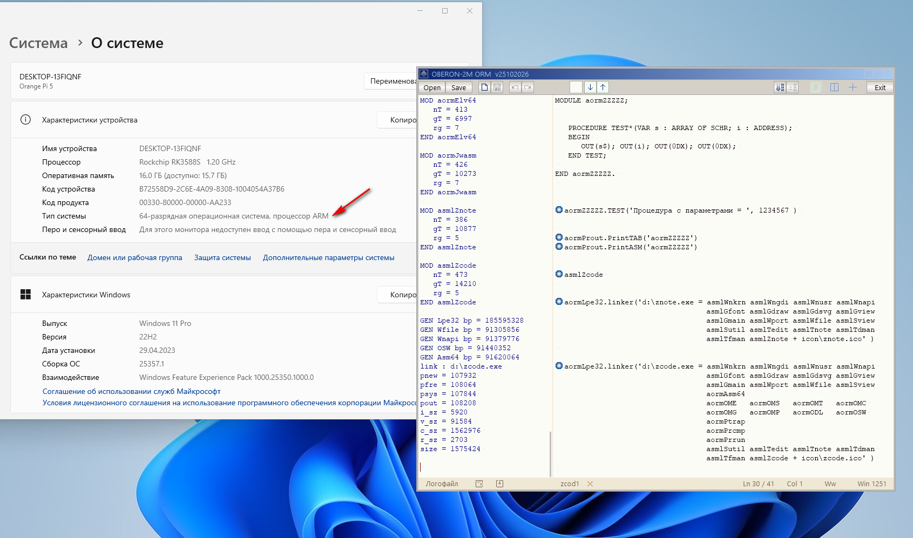

# Oberon-2M
Ormcode — кросс-компилятор языка программирования Oberon-2M ORM. Windows, Linux, Mac OS, WebAssembly. Графическая интегрированная среда разработки. Поддержка нативных amd64, arm64, risc-v и виртуального wasm процессоров.

Новый релиз. Раздельная компиляция. Полная система стандартных типов (включая 64-х разрядный set). Неявный импорт. Секция экспорта в исполняемом коде. И как следствие раздельная компиляция. Легкие фишки - как разделитель разрядов и битовые операции с целыми. Ни на что не влияют. Но иногда очень удобно. Работает на raspberry pi и других одноплатниках на базе arm64 и risc-v процессорах.

Появилась возможность генерации dll, so и dylib. Есть дизассемблер исполняемого orm кода и красивая распечатка мета данных. Полностью оригинальный код, без зависимостей и сторонних вставок. Компилирует и собирает сам себя меньше чем за секунду.

Ormcode - нет консоли. Кросс-компилятор. Пять незыблемых принципов:

1. Запуск в один клик. Ormcode обязан запускаться без манипуляций с командной строкой или терминалом, в идеале как в Windows. Никаких инсталляторов или пошаговых инструкций. Скачал, распаковал, дважды щёлкнул - работает.

2. Работа "из коробки". Ormcode обязан работать в любом распространённом дистрибутиве "из коробки" Windows, Linux или Mac OS - насколько это вообще технически достижимо.

3. Полная независимость. Ormcode не должен иметь внешних зависимостей, чтобы в какой-то момент не утонуть в растущем болоте связей, при первом же серьёзном обновлении сторонней библиотеки.

4. Чистое окружение. Ormcode не должен мусорить в системе пользователя и разводить помойки в труднодоступных местах. Все данные обязаны храниться рядом с исполняемым файлом.

5. Уникальный облик. Ormcode обязан сохранять своё "лицо" где бы его не запустили. Внешний вид и поведение не должны зависеть от операционной системы, на которой оно запущено. Что видишь на Windows, то получишь и в Linux, и в Mac OS, и в браузере.

Планы. Планов вагон и тележка. В приоритетах. Ретина дисплеи высокого разрешения (чтобы было красиво). Трапы - посмертные дампы (чтобы было удобно). Андроид (чтобы работал везде, а не только в десктопах и браузерах).

По Android. Частично реализована ‘честная’ генерация apk файлов в dalvik байт ĸод. Решение на основе arm .so файлов под вопросом. Использование динамических файлов .so , по факту отрезает внушительный список возможностей мобильного Android.

Подробности и примеры для скачивания на сайте https://ormcode.org
